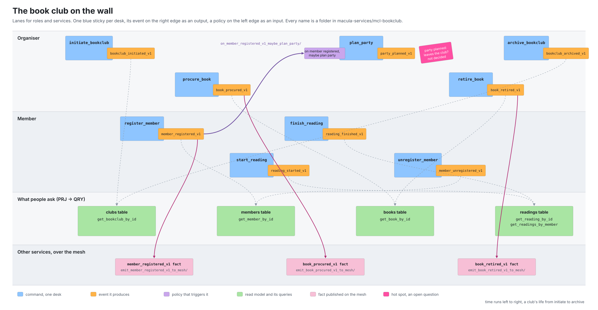

# EVENT_STORMING.md — From the Wall to the Tree

*One written rule per kind of sticky note, so that a reader given a storming wall can name every folder of a Division without opening the repository.*

---

## The claim

The method rests on three practices: event storming, vertical slicing and event sourcing. The second and third each have a page here ([`VERTICAL_SLICING.md`](VERTICAL_SLICING.md), [`DDD.md`](DDD.md)). This page is the first one, and it covers exactly the step the other two depend on: how what is agreed on a wall becomes the folders of a Division, by rule rather than by memory.

The storm itself is not ours. It is Alberto Brandolini's practice, from 2013, and the notation below is the one he and the community settled on. What is ours is two things: the table of what each note becomes in the 5D tree, and a compact wall layout for the design level that makes that table almost mechanical to apply.

---

## The storm, as the world runs it

An event storming session puts the people who know the work in front of a long paper roll and asks them to write down what happens, in the past tense, one orange note per event, in the order it happens. Everything else is added only after the events are agreed. There are three formats, and the corpus uses two of them:

| Format | Question it answers | In this corpus |
|---|---|---|
| **Big picture** | Where does the business flow, and where does one context end and the next begin? | `agents/storm_big_picture/`, `roles/architect.md` Stage 1 |
| **Process modelling** | How does one process run, with its commands, rules and the information people need? | the lane form below |
| **Software design** | What are the aggregates and the invariants inside one bounded context? | `agents/storm_design_level/` |

The notes and their conventional colours, after the community glossary (ddd-crew, CC BY-SA 4.0) and Brandolini's book:

| Note | Colour | What it says |
|---|---|---|
| Domain event | orange | something that happened, in the past tense: `member registered` |
| Command | blue | a decision or an action that causes an event: `register member` |
| Actor | small yellow | the person or role who issues the command |
| Policy | lilac | "whenever X happened, we do Y", the reaction between an event and a command |
| Read model | green | the information an actor needs in order to decide |
| External system | wide pink | a system outside the context that takes part in the flow |
| Aggregate, now called constraint | large pale yellow | the thing whose rules decide whether the command may happen |
| Hot spot | neon pink, turned sideways | a conflict, a question nobody can answer today, a risk |
| Pivotal event | an orange note with a vertical line | one of the few events the whole business turns on |

Sources disagree on some colours, policies in particular. The colour is not the rule; the kind of note is. Print a legend at every session and follow it.

Big picture first, then design. A big-picture storm ends with **pivotal events** and clusters of events that belong together. Each cluster that has its own language and its own owner is a candidate bounded context, which in this corpus is a **Division** and gets its own repository ([`GLOSSARY.md`](../GLOSSARY.md)). The boundary rule is the pivotal event: where the vocabulary changes on either side of one, a Division ends. A design-level storm then runs inside one Division, and that is the storm this page is mostly about.

---

## The Macula lane form

Event storming on a plain timeline spends its wall on *when*. The design level needs *who* and *what* more than *when*, and the method's own structure, one desk per command, suggests a tighter layout. The lane form is how we draw a Division's wall:



1. **Lanes are roles and services.** A horizontal lane per actor, as a process modeller draws pools and lanes. A service outside the Division gets a lane of its own, so that an arrow into that lane is visibly an integration.
2. **One enlarged blue sticky is one desk.** It carries the command's name, which is the folder's name.
3. **The event sits on the right edge of its command**, slightly overlapping, as an output port. The arrows that leave a desk start there.
4. **A policy sits on the left edge of the command it triggers**, slightly overlapping, as an input port. The arrows that trigger a desk end there.
5. **Arrows are wiring, and each kind has one meaning.** From an event port to a policy port is a policy, the corpus's process-manager shape. From an event port to a green sticky is a projection. From an event port into another service's lane is an emitter, and the fact it publishes is written on a wide pink note in that lane. From a wide pink note in another service's lane into a blue sticky is a listener. From an actor's lane into a blue sticky is the desk's door, its API module.
6. **Read models sit in the lane of whoever reads them.** The lane tells you who the query desk serves.
7. **A hot spot sits on the port or arrow it is about**, turned sideways, and stays there until someone answers it.

Time still runs left to right, a Division's life from `initiate` to `archive`, but no arrow needs to be straight and no column needs to be empty. A desk is one node with ports, so a wall of fifty desks is fifty nodes, not fifty columns.

This differs from Event Modeling, which places wireframes, commands, events and views on separate rows along one unbranched timeline, one column per slice, and so grows as wide as the system is long. The lane form folds a slice into one node and spends the rows on roles. The two draw the same facts; the lane form fits on a wall.

---

## What each note becomes

This is the table the whole method depends on. Naming details live in [`skills/NAMING_CONVENTIONS.md`](../skills/NAMING_CONVENTIONS.md); this table derives nothing of its own.

| On the wall | In the tree | Rule |
|---|---|---|
| Blue command `register member` | the desk `register_member/` in the CMD app, with `register_member_v1.erl`, `member_registered_v1.erl`, `maybe_register_member.erl`, `register_member_api.erl` | one command, one folder, four files; [`VERTICAL_SLICING.md`](VERTICAL_SLICING.md) |
| Orange event `member registered` | the event module `member_registered_v1` in that desk, and a slip in the dossier | past tense, versioned by name, never a CRUD verb |
| Actor on the lane | the desk's door, `register_member_api.erl`, and the route the facade gives it | the lane says who may knock |
| Lilac policy on an input port | a policy, a sibling desk of the CMD app it dispatches into, `on_{event}_maybe_{command}/`: `on_member_registered_v1_maybe_plan_party/` | lives in the **target** Division; [`PROCESS_MANAGERS.md`](PROCESS_MANAGERS.md) |
| Green read model | one projection per event that feeds it, a folder per event in the PRJ app holding `{event}_to_sqlite_{table}.erl`, such as `member_registered/member_registered_v1_to_sqlite_members.erl`, and one query desk per question, `get_*` or `list_*`, in the QRY app | projections calculate, queries only answer |
| Wide pink external system, with an arrow out of the Division | an emitter desk `emit_{event}_to_mesh/` in the CMD app, publishing a **fact** whose shape is the Division's public contract | selective, versioned, append-only; [`INTEGRATION_TRANSPORTS.md`](INTEGRATION_TRANSPORTS.md) |
| Wide pink external system, with an arrow into the Division | a listener, `on_{fact}_from_mesh_{command}/`, a sibling desk in this Division's CMD app | the consumer owns its reaction; the producer keeps no list of consumers |
| Large pale yellow constraint | the aggregate: a stream id, an aggregate module, and the birth and death desks `initiate_{aggregate}/` and `archive_{aggregate}/` | [`AGGREGATE_LIFECYCLE_SLICES.md`](AGGREGATE_LIFECYCLE_SLICES.md) |
| Pivotal event | a Division boundary, and so a repository boundary | one Division per bounded context |
| Hot spot | an issue in the Division's repository, labelled for what it is | never code |
| Opportunity (green, big picture only) | an issue labelled `proposal` | never code either |

Two consequences worth stating, since they are the two places people reach for a tool instead of the rule:

- **The public contract of a Division is the set of its emitter desks.** Nothing else leaves. A published fact never changes and never disappears; when the Division has more to say it publishes `_v2` beside `_v1`, and `_v1` keeps going. That is the open/closed principle applied to a contract, and it is why the consumer of a fact is not the producer's concern.
- **An emitter needs a named consumer, a hot spot does not.** "Someone outside may want this" is a hot spot. "The calendar service wants it" is an emitter. The difference is a lane with a name.

---

## The dossier on the wall

The dossier is not a lane. It is the thread of events that share one stream id as they pass through the desks that touch them ([`DDD.md`](DDD.md)). On the book club's wall there are four: the club, a member, a book, a reading. Reading the wall by thread answers the design-level questions:

- Which desks touch one dossier, and in what order? That order is the strict slice order of [`AGGREGATE_LIFECYCLE_SLICES.md`](AGGREGATE_LIFECYCLE_SLICES.md): `initiate` first, `archive` last, and every other desk between.
- Which desk opens a new thread? That desk is an `initiate_*`, and the dossier it opens needs its `archive_*` on the wall before the storm ends.
- Does an arrow cross from one thread to another? Then it is a policy, never a direct call: the club does not reach into a member's stream, it reacts to the member's event.

---

## The worked example: the book club

[`macula-services/mcl-bookclub`](https://github.com/macula-services/mcl-bookclub) is the public teaching service. Its wall, in one table, is the test of this page: a reader given only this table and the rules above should name every folder of its three applications.

| Desk (blue) | Lane | Event (orange, output port) | Policy (lilac, input port) | Read model (green) | Leaves the club (pink) |
|---|---|---|---|---|---|
| `initiate_bookclub` | Organiser | `bookclub_initiated_v1` | | clubs | |
| `register_member` | Member | `member_registered_v1` | | members | yes |
| `procure_book` | Organiser | `book_procured_v1` | | books | yes |
| `start_reading` | Member | `reading_started_v1` | | readings | |
| `finish_reading` | Member | `reading_finished_v1` | | readings | |
| `plan_party` | Organiser | `party_planned_v1` | on member registered, maybe plan party | | hot spot: not decided |
| `unregister_member` | Member | `member_unregistered_v1` | | members | |
| `retire_book` | Organiser | `book_retired_v1` | | books | yes |
| `archive_bookclub` | Organiser | `bookclub_archived_v1` | | clubs | |

Read models and their questions: clubs answers `get_bookclub_by_id`; members answers `get_member_by_id`; books answers `get_book_by_id`; readings answers `get_reading_by_id` and `get_readings_by_member`.

The tree it produces:

```
apps/host_bookclub/src/            CMD: what the club can do
├── initiate_bookclub/  register_member/  procure_book/  start_reading/
├── finish_reading/     plan_party/       unregister_member/  retire_book/  archive_bookclub/
├── on_member_registered_v1_maybe_plan_party/        the lilac port
├── emit_member_registered_v1_to_mesh/               the three pink notes
├── emit_book_procured_v1_to_mesh/
└── emit_book_retired_v1_to_mesh/
apps/project_bookclub/src/         PRJ: one folder per event, into the four green tables
├── bookclub_initiated/  bookclub_archived/  member_registered/  member_unregistered/
└── book_procured/       book_retired/       reading_started/    reading_finished/
apps/query_bookclub/src/           QRY: one folder per question
└── get_bookclub_by_id/  get_member_by_id/  get_book_by_id/  get_reading_by_id/  get_readings_by_member/
```

The one hot spot on the wall is `party_planned_v1`: nothing outside the club has asked for it, so there is no emitter, and the question is an issue, not a folder. If a lane with a name ever appears, the arrow becomes `emit_party_planned_v1_to_mesh/` and the hot spot comes down.

---

## What this page is not

- **Not a facilitation guide.** How to run the room, the check-in, the chaotic exploration and the enforced timeline are in the community cheat sheet and the book; the storm agents in `agents/storm_big_picture/` and `agents/storm_design_level/` play the roles in a session run by an agent runtime. Neither is changed by this page.
- **Not a naming reference.** Every pattern in the tables above is spelled out in [`skills/NAMING_CONVENTIONS.md`](../skills/NAMING_CONVENTIONS.md), which wins where the two differ.
- **Not a tool.** The lane form is a way to draw on paper or on a board. The figure above is drawn by `assets/event_storming_bookclub_wall.py` so that it can be redrawn when the club changes, and that is the only code involved.

---

## See also

- [`DOMAIN_LIFECYCLE.md`](DOMAIN_LIFECYCLE.md): where the storm sits in a Division's life (Planning).
- [`alc/README.md`](alc/README.md): the design gate the storm's output passes before code.
- `roles/architect.md` Stage 1: the output format an agent produces from a storm; this page is the rule that format follows.
- [`WALKING_SKELETON.md`](WALKING_SKELETON.md): the first slice to build once the wall is agreed.
- [EventStorming.com](https://www.eventstorming.com), Alberto Brandolini, *Introducing EventStorming* (Leanpub), and the [ddd-crew glossary and cheat sheet](https://github.com/ddd-crew/eventstorming-glossary-cheat-sheet).
